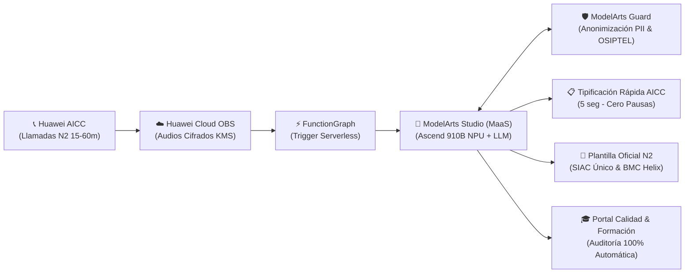

# 🚀 AICC BO Assistant — Huawei Cloud Peru Hackathon 2026

**Plataforma de Auditoría Universal con Huawei AICC, Protección Anti-Pausa y Generación Automatizada de Plantillas para SIAC Único y Helix con Huawei Cloud MaaS.**

---

## 👥 Equipo: Los Ejecutores

* **Drey Enmanuel Aymituma Julca (Líder de Proyecto & Backoffice N2 Architect)**  
  *Especialista en Backoffice Soporte Técnico N2 en Global Hitss. Creador de la arquitectura de integración con Huawei Cloud, lógica operativa y diseño de solución.*
* **Hector Armando Poma Hernandez (Ingeniero de IA & MaaS Specialist)**  
  *Implementación de ModelArts Studio (MaaS), orquestación de modelos LLM (Qwen 2.5 72B / Pangu NLP), procesamiento de contextos extensos y seguridad con ModelArts Guard.*
* **Gean Franco Quinto Zapana (Desarrollador Full-Stack & Integración AICC)**  
  *Desarrollo del dashboard operativo en tiempo real, integración con telefonía Huawei AICC y conectividad con sistemas transaccionales (SIAC Único y BMC Helix).*

* **Evento:** Huawei Cloud Peru MaaS Hackathon 2026 — Sede Blue Tower, Piso 2  
* **Fecha:** Noviembre de 2026

---

## 📌 Contexto Operativo Real: El Drama Diario en Backoffice N2 (Global Hitss / Claro)

A diferencia de un call center de ventas con llamadas cortas de 2 o 3 minutos, en el **Backoffice de Soporte Técnico de Segundo Nivel (N2)** las llamadas suelen durar **entre 15 minutos y más de 1 hora** debido a los complejos descartes técnicos en sistemas como **Incógnito** (DOCSIS / niveles ópticos), **Schaman** (alertas masivas de nodo), **Tracer** (consumo y cortes de energía) y **TR-069** (canales WiFi saturados).

### 1. La División Operativa del Trabajo
* **Asesores de Primer Toque:** Se asignan o reciben casos nuevos y realizan el primer contacto. Si el cliente no contesta, deben iniciar el estricto protocolo de **Ciclo de Llamadas 2x3** (3 intentos de llamada cada 2 horas por 2 días).
* **Asesores de Colas de Llamadas (Marcador Robot AICC):** Un marcador predictivo automático de **Huawei AICC** llama a los clientes que quedaron en ciclo y, cuando uno atiende, le transfiere la llamada inmediatamente al asesor disponible.

### 2. El Cuello de Botella: La Trampa de la Pausa de 3 Minutos
* En Huawei AICC, el tiempo en pausa (Aux / ACW) está **hiper-auditado a un máximo de 3 minutos**.
* Si el asesor supera los 3 minutos para redactar su caso, supervisión vocea por sala o chat: *«¡Despáuseense!»*.
* Si el asesor se despausa bajo presión, **el robot de AICC le dispara una nueva llamada de inmediato ("back-to-back")**, impidiendo terminar de documentar el caso anterior.

### 3. La Doble Carga y la Auditoría Horaria de AICC
* **En Huawei AICC solo se tipifica lo básico:** Al colgar la llamada, el asesor solo ingresa el código del caso y el nombre del cliente.
* **Toda la plantilla técnica detallada debe subirse manualmente a dos sistemas externos:** **SIAC Único** y **BMC Helix**, tardando entre 3 y 5 minutos por llamada.
* **Auditoría Horaria de AICC:** Si al asesor le caen llamadas consecutivas y deja tipificaciones pendientes en AICC, es penalizado en la auditoría horaria de operaciones.

### 4. El Colapso de Calidad y Formación
* Para un auditor humano de **Calidad o Formación**, escuchar una llamada de 45 a 60 minutos consume una hora completa de su jornada solo para evaluar **un único caso**.
* Por esta limitación humana, **apenas auditan menos del 1% de las interacciones**, perdiendo visibilidad sobre averías masivas, vicios de atención y necesidades reales de capacitación técnica.

---

## 💡 La Solución: AICC BO Assistant

**AICC BO Assistant** une la telefonía **Huawei AICC** con la inteligencia artificial de **Huawei Cloud ModelArts Studio (MaaS)** para resolver este drama operativo en tiempo real:

### Capacidades Principales
1. **Protección Anti-Pausa y Modo Back-to-Back en AICC:**
   * Mientras el asesor habla con el cliente, MaaS procesa el audio en vivo. Al colgar, autocompleta la ventana de AICC en **5 segundos**, garantizando el **100% de cumplimiento en la auditoría horaria**.
   * El asesor se despausa en menos de 15 segundos, listo para la siguiente llamada del robot sin acumular trabajo pendiente.
2. **Generación Automatizada de la Plantilla Hitss para SIAC Único y Helix:**
   * Extrae automáticamente el teléfono, problema detectado, los descartes técnicos en Incógnito (según la norma oficial del **Flyer N° 41**), Schaman, TR-069 y el número de SOT, dejándola lista para copiar o inyectar con 1 solo clic.
3. **Gestión Automatizada de Ciclo de Llamadas (Primer Toque):**
   * Detecta llamadas no contestadas o buzón de voz y genera de forma automática la plantilla de ciclo (*1er intento cada 2 horas por 2 días*) en AICC y SIAC.
4. **Desbloqueo de Calidad y Formación (100% Cobertura):**
   * Evalúa llamadas de hasta 1 hora en **240 milisegundos**, calificando la adherencia técnica a las matrices de descarte y generando diagnósticos pedagógicos automáticos para los instructores de Formación.
5. **Retención Proactiva y Blindaje OSIPTEL:**
   * Detecta señales de portabilidad (clientes que mencionan a Entel/Movistar) y sugiere al asesor la mejor oferta de retención en vivo (*Next Best Offer*), alertando además sobre la entrega obligatoria del código de reclamo para evitar multas.

---

## 📊 Impacto Operativo y Financiero (Métricas de Negocio)

| Métrica Operativa | Situación Tradicional (Hoy) | Con AICC BO Assistant |
| :--- | :--- | :--- |
| **Cobertura de Auditoría Calidad/Formación** | `< 1.0%` (muestreo manual ciego) | **`100%` de llamadas auditadas** |
| **Tiempo de Redacción ACW (SIAC / Helix)** | `3 a 5 minutos` por llamada | **`15 segundos` (Autocompletado)** |
| **Sobre-Pausas de Asesores (>3 min)** | Frecuentes (voceos de supervisión) | **`0%` de sobre-pausa por tipificación** |
| **Aprobación en Auditoría Horaria AICC** | Variable por llamadas back-to-back | **`100%` de tipificaciones al día** |
| **Horas-Hombre Mensuales Liberadas en N2** | `0 h` | **`+5,300 horas-hombre / mes`** *(en 80k llamadas)* |
| **Ahorro Anual Estimado (Churn + Multas)** | Pérdida millonaria | **`$1.35M USD` anuales proyectados** |
| **Costo por Llamada Auditada en MaaS** | Alto (costo hora-hombre auditor) | **`~$0.003 USD` (Pay-per-Token)** |

---

## 📂 Estructura del Repositorio

* **`index.html`**: Simulador web interactivo completo (Dashboard estilo enterprise con Tailwind CSS, Chart.js, Lucide icons, reproductor de audio con onda visual y llamadas reales de N2).
* **`abrir_demo.bat`**: Script de inicio rápido en Windows para abrir la demo en el navegador predeterminado.
* **`Huawei Cloud Peru MaaS Hackathon Template External.pptx`**: Presentación oficial de la Hackathon completada con las 14 diapositivas estructuradas.
* **`GUION_VIDEO_DEMO.md`**: Guion segundo a segundo (1 min 45 seg) para la grabación del video demostrativo.
* **`build_full_presentation.py`**: Código fuente en Python para compilar y actualizar la presentación de PowerPoint automáticamente.

---

## 🛠️ Cómo Ejecutar y Demostrar la Solución

1. **Abrir la Demo Interactiva:**
   * Haz doble clic en `abrir_demo.bat` o abre `index.html` en Chrome/Edge.
2. **Probar los Casos de Negocio:**
   * **Caso 1 (Cola de Marcador Robot AICC - 38 min):** Cliente con lentitud HFC. MaaS analiza el audio, detecta Upstream fuera de rango (Flyer 41) y genera la plantilla oficial para SIAC Único y Helix con SOT.
   * **Caso 2 (Primer Toque - 24 min):** Cobertura FTTH con bucle de repetidores de terceros y diagnóstico para Formación sobre equipos Plume.
   * **Caso 3 (Primer Toque - No Contesta):** Llamada saliente que cae a buzón y activa automáticamente la plantilla del Ciclo 2x3.
3. **Copiar Plantillas en 1 Clic:**
   * Haz clic en **"Copiar para AICC"**, **"Copiar para SIAC Único"** o **"Copiar para Helix"** para ver la notificación en pantalla.

---

Desarrollado con orgullo para la <strong>Huawei Cloud Peru MaaS Hackathon 2026</strong> por el equipo <strong>Los Ejecutores</strong>.

